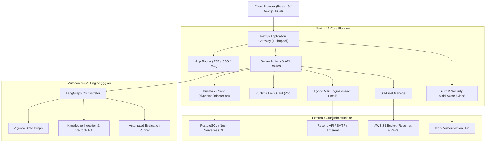

# InGrowwth Innovations

<div align="center">


<p align="center">
  <strong>Enterprise-Grade Digital Solutions, AI-Powered Workflows, and Cloud Architecture</strong>
</p>

<p align="center">
  A state-of-the-art web platform engineered with <strong>Next.js 16 (Turbopack)</strong>, <strong>React 19</strong>, <strong>Tailwind CSS v4</strong>, <strong>Prisma 7</strong>, <strong>Clerk Auth</strong>, and an autonomous <strong>LangGraph AI Agentic Runtime</strong>.
</p>

</div>

---

## 📑 Table of Contents

- [Executive Overview](#-executive-overview)
- [System Architecture](#-system-architecture)
- [Core Feature Modules](#-core-feature-modules)
- [Tech Stack](#-tech-stack)
- [Project Directory Structure](#-project-directory-structure)
- [Getting Started](#-getting-started)
  - [Prerequisites](#prerequisites)
  - [Environment Configuration](#environment-configuration)
  - [Database Provisioning & Migrations](#database-provisioning--migrations)
  - [Running the Development Server](#running-the-development-server)
- [Prisma 7 Database Layer](#-prisma-7-database-layer)
- [Autonomous AI Engine (`igg-ai`)](#-autonomous-ai-engine-igg-ai)
- [Containerization & Docker](#-containerization--docker)
- [CI/CD & Code Quality Standards](#-cicd--code-quality-standards)
- [Environment Variables Matrix](#-environment-variables-matrix)
- [Health Check & Telemetry](#-health-check--telemetry)
- [Security & Governance](#-security--governance)

---

## 🏛 Executive Overview

The **InGrowwth Innovations** enterprise platform serves as both a high-conversion client showcase and an operational hub for agency management. It bridges bespoke agency marketing with mission-critical administrative operations, featuring:

- **Ultra-Responsive Luxury Client Experience**: Micro-interactions powered by Framer Motion, Lenis smooth scrolling, glassmorphic UI, dynamic quote request engines, and MNC-grade career portals.
- **Enterprise Operations CMS**: Granular administration of dynamic case studies, portfolio showcases, job listings, applicant pipelines, newsletters, and incoming customer leads.
- **Agentic AI & Observability**: Embedded `igg-ai` runtime integrating LangGraph state machines, automated query evaluation pipelines, and vector/RAG observability.
- **Hybrid Transactional Email Dispatcher**: Multi-provider email router supporting Resend for production, custom SMTP relays, and zero-config Ethereal testing with React Email templates.
- **Security-First Infrastructure**: Role-based access control with Clerk, AWS S3 authenticated file handling, strict Zod environment verification, and Prisma connection pooling.

---

## 🏗 System Architecture



---

## 🌟 Core Feature Modules

### 1. High-Performance Client Web Experience

- **Interactive RFP & Quote Studio**: Dynamic multi-tier budget and service picker with drag-and-drop RFP file uploads directly to AWS S3.
- **Enterprise Career Portal**: MNC-standard job application wizard featuring section quick-jump pills, LinkedIn integration, and client-side PDF verification with a 10MB limit.
- **Dynamic Case Studies & Portfolio**: Real-time project showcases synchronized directly with the database, featuring before/after metrics and architectural breakdowns.
- **Interactive Consultant Chat**: Embedded streaming chat assistant with booking handoff cards and Markdown rendering.

### 2. Executive Management Dashboard (`/admin`)

- **Telemetry & Leads CMS**: Live lead pipeline tracking (`NEW`, `CONTACTED`, `CLOSED`), inquiry analytics, and direct-to-customer rich email replies.
- **Recruitment & Applicant Tracking (ATS)**: Filterable candidate applications with direct PDF resume previews, status progressions, and automated candidate notifications.
- **Newsletter Studio & Campaign Manager**: Visual email campaign composer with draft previews, subscriber segmentation, and batch email dispatch.
- **Dynamic Content Management**: Instant CRUD controls for services, case studies, client portfolio items, blog posts, and team leadership profiles.

### 3. Enterprise Email System

- **Hybrid Multi-Provider Architecture**: Intelligent routing through Resend (production), custom SMTP, or zero-config Ethereal test preview URLs in development.
- **Type-Safe React Email Templates**: Beautiful branded templates for admin alerts, lead confirmation receipts, career candidate acknowledgements, and newsletter campaigns.

---

## 💻 Tech Stack

| Domain                   | Technology                               | Description                                                |
| :----------------------- | :--------------------------------------- | :--------------------------------------------------------- |
| **Framework**            | Next.js 16.2.10                          | App Router, Server Components, Turbopack                   |
| **Runtime & Language**   | Node.js 20+ / TypeScript 5               | Strictly typed fullstack architecture                      |
| **UI & Styling**         | Tailwind CSS v4, Lucide React, Radix UI  | Utility-first styling with modern accessibility primitives |
| **Animations & FX**      | Framer Motion, Lenis                     | Micro-interactions and buttery-smooth inertial scrolling   |
| **Database & ORM**       | PostgreSQL, Prisma 7.8.0                 | Driver adapters (`@prisma/adapter-pg`), Neon pooling       |
| **Authentication**       | Clerk (`@clerk/nextjs`, `@clerk/themes`) | Enterprise authentication, session handling, RBAC          |
| **AI Orchestration**     | LangGraph, LangChain Core                | State-machine AI agents, evaluation harnesses, RAG         |
| **Object Storage**       | AWS SDK v3 (`@aws-sdk/client-s3`)        | Presigned URLs and secure document uploads                 |
| **Email Infrastructure** | Resend, React Email, Nodemailer          | Transactional and marketing broadcast dispatcher           |
| **Form Handling**        | React Hook Form, Zod                     | Type-safe form validation and schema definitions           |
| **Containerization**     | Docker, Docker Compose                   | Production-grade multi-stage container images              |

---

## 📂 Project Directory Structure

```plaintext
InGrowwth_Innovations/
├── .github/
│   └── workflows/              # GitHub Actions CI/CD pipelines
│       ├── ci.yml              # Linting, Prisma generation, AI evals, Next.js build
│       ├── docker.yml          # Docker sanity build validation
│       ├── pr-title-check.yml  # Conventional Commit pull request validator
│       └── release.yml         # Production release workflows
├── igg-ai/                     # Autonomous AI & Observability Framework
│   ├── core/                   # Core agent configuration and managers
│   ├── evals/                  # Evaluation runner and test datasets
│   ├── ingestion/              # Document and data ingestion pipelines
│   ├── rag/                    # Retrieval-augmented generation engine
│   └── runtime/                # LangGraph orchestrator and state graph
├── prisma/
│   ├── schema.prisma           # Prisma 7 database schema definitions
│   ├── migrations/             # Timestamped SQL database migrations
│   ├── seed.ts                 # Production & base database seeding
│   └── seed-demo.ts            # Enterprise demo dataset generator
├── public/                     # Static assets, branding, and icons
├── src/
│   ├── actions/                # Server Actions (Lead creation, mutations)
│   ├── app/                    # Next.js App Router (Pages, layouts, API endpoints)
│   │   ├── (public)/           # Public routes (Home, About, Portfolio, Contact, etc.)
│   │   ├── admin/              # Executive CMS and ATS management suite
│   │   └── api/                # REST endpoints and webhooks
│   ├── components/             # Reusable atomic and composite UI elements
│   │   ├── emails/             # React Email transactional templates
│   │   ├── shared/             # Headers, footers, and global wrappers
│   │   └── ui/                 # Accessible base UI primitives (Shadcn / Radix)
│   ├── generated/              # System-generated outputs (Prisma client)
│   ├── lib/                    # Core utilities, DB singleton, logger, env validation
│   └── schemas/                # Shared Zod validation schemas
├── Dockerfile                  # Multi-stage production container build
├── docker-compose.yml          # Local containerized infrastructure (Postgres + App)
├── eslint.config.mjs           # ESLint 9 Flat Config
├── next.config.ts              # Next.js runtime & compiler configuration
├── package.json                # Project dependencies and script declarations
├── prisma.config.ts            # Prisma 7 configuration and connection resolver
└── tsconfig.json               # TypeScript compiler configuration
```

---

## 🚀 Getting Started

### Prerequisites

Ensure you have installed:

- **Node.js**: `v20.0.0` or higher (Node 22 LTS recommended)
- **npm**: `v10.0.0` or higher
- **Docker Desktop**: For running local PostgreSQL and testing containers
- **Git**

### Environment Configuration

Clone the repository and prepare your environment file:

```bash
# Clone the repository
git clone https://github.com/MEETT007/InGrowwth_Innovations.git
cd InGrowwth_Innovations

# Copy the environment template
cp .env.example .env.local
```

Open `.env.local` and configure your credentials (see [Environment Variables Matrix](#-environment-variables-matrix) below).

### Database Provisioning & Migrations

You can launch a local PostgreSQL container using Docker Compose:

```bash
# 1. Start the PostgreSQL container in the background
docker compose up postgres -d

# 2. Install all dependencies
npm install

# 3. Generate the Prisma Client
npx prisma generate

# 4. Run database migrations
npx prisma migrate dev

# 5. (Optional) Seed the database with enterprise demo content
npm run db:seed
```

### Running the Development Server

Start the Next.js development server with Turbopack:

```bash
npm run dev
```

Visit [http://localhost:3000](http://localhost:3000) in your browser.

---

## 🗄 Prisma 7 Database Layer

This project uses **Prisma 7**, where connection strings are dynamically managed via `prisma.config.ts` rather than hardcoded in `schema.prisma`.

### Common Database Scripts

```bash
# Apply pending migrations locally
npm run db:migrate:dev

# Deploy migrations to production (used in CI/CD & Vercel)
npm run db:migrate:deploy

# Seed the database
npm run db:seed

# Launch Prisma Studio database GUI (accessible at http://localhost:5555)
npm run db:studio

# Validate Prisma schema
npx prisma validate
```

> **Security Note:** In development, `prisma.config.ts` incorporates a safety guard preventing accidental execution of dev migrations against remote production databases.

---

## 🤖 Autonomous AI Engine (`igg-ai`)

The `igg-ai` module is an in-house agentic AI framework tailored for enterprise consultancy and knowledge retrieval:

- **LangGraph Orchestrator**: Directs multi-turn conversational agents with stateful checkpoints.
- **RAG & Ingestion**: Converts internal case studies and technical documentation into searchable embeddings.
- **Continuous Evaluation**: Runs deterministic test scenarios evaluating latency, groundedness, and response relevance.

To run the automated AI evaluation harness:

```bash
npx tsx igg-ai/evals/source/EvalRunner.ts
```

---

## 🐳 Containerization & Docker

The repository includes a production-ready, security-hardened `Dockerfile` and `docker-compose.yml`.

### Running the Full Production Stack Locally

```bash
# Build and run the Next.js app and PostgreSQL replica
docker compose up --build -d

# View live application logs
docker compose logs -f

# Stop all running containers
docker compose down

# Teardown containers and clean database volume
docker compose down -v
```

The containerized web application will be accessible at [http://localhost:3000](http://localhost:3000), with the PostgreSQL port forwarded to `localhost:5435`.

---

## 🛡 CI/CD & Code Quality Standards

Code quality and deployment workflows are strictly enforced using **GitHub Actions**, **Husky**, and **Commitlint**:

### Quality Workflows

- **`Next.js CI & Code Quality` (`ci.yml`)**:
  1. Installs clean dependencies via `npm ci`
  2. Generates the Prisma client (`npx prisma generate`)
  3. Executes ESLint 9 checks (`npm run lint`)
  4. Runs autonomous AI test suite (`EvalRunner.ts`)
  5. Performs optimized production compilation (`npm run build`)
- **`Docker Build Validation` (`docker.yml`)**: Validates that the multi-stage Docker build passes clean container image generation.
- **`PR Title Validator` (`pr-title-check.yml`)**: Enforces the [Conventional Commits](https://www.conventionalcommits.org/) standard on all Pull Request titles.

### Git Hooks & Local Quality Commands

```bash
# Run ESLint validation
npm run lint

# Run TypeScript type verification
npm run typecheck

# Format codebase with Prettier
npx prettier --write .
```

All commits must follow Conventional Commits formatting (e.g., `feat: ...`, `fix: ...`, `chore: ...`).

---

## 🔑 Environment Variables Matrix

| Variable                                              | Scope  | Required | Description                                                     |
| :---------------------------------------------------- | :----- | :------: | :-------------------------------------------------------------- |
| `APP_ENV`                                             | Server |    No    | `development` or `production` (defaults to `development`)       |
| `DATABASE_URL`                                        | Server | **Yes**  | PostgreSQL connection URI (`postgresql://...`)                  |
| `CLERK_SECRET_KEY`                                    | Server | **Yes**  | Clerk backend secret key                                        |
| `NEXT_PUBLIC_CLERK_PUBLISHABLE_KEY`                   | Client | **Yes**  | Clerk frontend publishable key                                  |
| `NEXT_PUBLIC_APP_URL`                                 | Client |    No    | Base application URL (e.g., `http://localhost:3000`)            |
| `EMAIL_PROVIDER`                                      | Server |    No    | `resend`, `smtp`, or `ethereal` (defaults to `ethereal` in dev) |
| `RESEND_API_KEY`                                      | Server |    No    | Required if `EMAIL_PROVIDER=resend`                             |
| `SMTP_HOST` / `SMTP_PORT` / `SMTP_USER` / `SMTP_PASS` | Server |    No    | Required if `EMAIL_PROVIDER=smtp`                               |
| `AWS_ACCESS_KEY_ID` / `AWS_SECRET_ACCESS_KEY`         | Server |    No    | AWS credentials for S3 uploads                                  |
| `AWS_BUCKET_NAME` / `AWS_REGION`                      | Server |    No    | Target S3 bucket and region                                     |

---

## 🩺 Health Check & Telemetry

The platform provides a dedicated health check endpoint for container probes and uptime monitors:

```bash
curl http://localhost:3000/api/health
```

Sample JSON response:

```json
{
  "status": "UP",
  "timestamp": "2026-10-13T22:50:00.000Z",
  "version": "0.1.0",
  "environment": "development",
  "checks": {
    "database": {
      "status": "UP"
    },
    "env": {
      "DATABASE_URL": "LOADED",
      "NEXT_PUBLIC_APP_URL": "LOADED"
    }
  }
}
```

---

## 🔒 Security & Governance

- **Zero-Secret Client Exposure**: Client and server environment schemas are isolated using strict Zod schemas in `src/lib/env.ts`. Sensitive keys are strictly blocked from client bundles.
- **Log Redaction**: Centralized logger (`src/lib/logger.ts`) automatically scrubs secret keys, API tokens, and passwords prior to logging.
- **Idempotent Mutations**: Critical transactional mutations utilize `IdempotencyKey` tracking to prevent duplicate submissions or race conditions.

---

<div align="center">

**&copy; 2026 InGrowwth Innovations. All rights reserved.**

</div>
